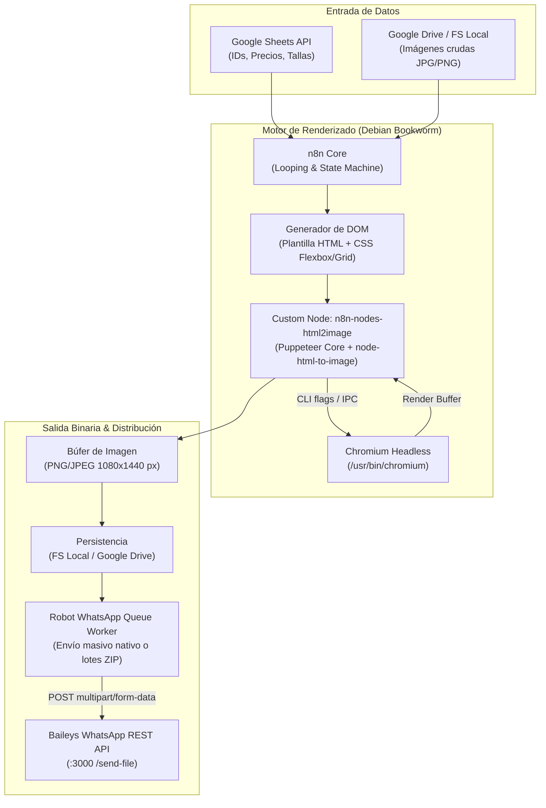

# CATALOGO-CREATOR

Motor de renderizado gráfico por lotes para generación automatizada de imágenes de catálogo a resolución fija (1080x1440 px), orquestado con n8n, Chromium Headless y sincronización de datos tabulares (Google Sheets).

---

## 1. Arquitectura Técnica



---

## 2. Componentes del Sistema

- **`Dockerfile`:** Imagen personalizada basada en `node:20-bookworm-slim` con dependencias del sistema para Chromium (`libnss3`, `libatk-bridge2.0-0`, `libxcomposite1`, `libxrandr2`, `libgbm1`, fuentes FreeFont y Noto Emoji).
- **`n8n-nodes-html2image/`:** Paquete de nodo comunitario desarrollado en TypeScript que compila a `dist/`. Implementa el renderizado por headless browser pasando las banderas:
  - `--no-sandbox`
  - `--disable-dev-shm-usage`
  - `--disable-gpu`
  - `--disable-software-rasterizer`
- **`flujos/active/`:**
  - `Motor_Render_Universal__Sub_Workflow_.json`: Subflujo aislado de renderizado que recibe un payload JSON estructurado `{ productId, cupPrice, usdPrice, productoBase64, logoBase64 }` y devuelve el archivo binario generado en memoria.
  - `YourBrand_Batch__Producci_n_Real__V3___RESTAURADO_.json`: Flujo orquestador por lotes con control de iteración y manejo de estados.
  - `Robot_WhatsApp_Queue_Worker.json`: Worker especializado en la entrega de las imágenes resultantes. Lee productos pendientes de Google Sheets, descarga las imágenes de Drive, comprime lotes de hasta 30 ítems en `.zip` o despacha imágenes individuales con pausas orgánicas vía la API de Baileys.
- **`docker-compose.yml`:** Orquestador multi-contenedor con servicio PostgreSQL 16 y el contenedor n8n con soporte Chromium preinstalado.

---

## 3. Especificaciones de Renderizado y Salida

- **Dimensiones del lienzo:** 1080 × 1440 píxeles.
- **Tipografía inyectada:** `Archivo Black` (display numérico) y `Open Sans` (pesos 400, 600, 700 vía Google Fonts).
- **Estructura DOM:** Contenedor Flexbox relativo con capa base para el producto y superposiciones absolutas para cabecera, insignias de tallas, badge de doble moneda (USD / CUP) y ganchos de texto.

---

## 4. Variables de Entorno (`.env.example`)

| Variable | Tipo | Descripción |
| :--- | :--- | :--- |
| `POSTGRES_USER` | string | Usuario de la base de datos PostgreSQL |
| `POSTGRES_PASSWORD` | string | Contraseña de PostgreSQL |
| `POSTGRES_DB` | string | Nombre de la base de datos relacional de n8n |
| `NODE_ENV` | string | Entorno de ejecución (`production` / `development`) |
| `N8N_ENCRYPTION_KEY` | string | Clave de cifrado interno para credenciales en n8n |
| `YOUR_PHOTOS_PATH`| path | Ruta del volumen local donde residen las fotos brutas |
| `YOUR_LOGO_PATH` | path | Ruta al archivo PNG del logotipo corporativo |
| `N8N_RUNNERS_TASK_REQUEST_TIMEOUT` | int | Timeout en segundos para tareas de render intensivo (default: 180) |
| `BAILEYS_API_URL` | string | URL base del microservicio Baileys WhatsApp |
| `BAILEYS_API_KEY` | string | Clave de autenticación para envío de archivos multimedia |

---

## 5. Instrucciones de Ejecución

### 5.1 Despliegue con Docker Compose
```bash
cp .env.example .env
docker compose up -d --build
```

### 5.2 Compilación del Nodo Custom (Desarrollo)
```bash
cd n8n-nodes-html2image
npm install
npm run build
```

### 5.3 Importación de los Flujos en n8n
```bash
docker exec -it n8n-app n8n import:workflow --input=/flujos/active/Motor_Render_Universal__Sub_Workflow_.json
```
