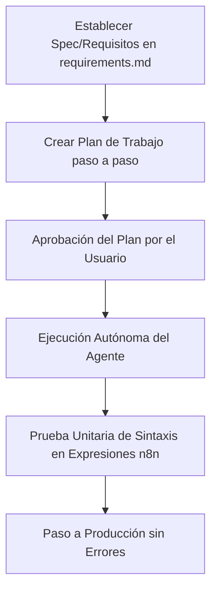

# 📊 Evaluación de Prompts y Flujo de Trabajo Agéntico

## Proyecto: n8nYourBrand
## Fecha de Evaluación: 6 de julio de 2026
## Evaluador: Roberto (AI Workflow Analyst)

---

## Resumen Ejecutivo

Este informe evalúa las interacciones y la calidad de los prompts del usuario en el proyecto **n8nYourBrand** (conversación `375a3ac7-e4b8-4b4f-9ae2-bff0f1799222`). El objetivo principal de la interacción del usuario con el agente de IA fue auditar, conectar y depurar flujos de trabajo en n8n mediante herramientas MCP (*Model Context Protocol*). 

* **Puntuación General:** **7.4 / 10**
* **Fortaleza Principal:** Excelente gestión de contexto (uso de resúmenes estructurados) y una mentalidad madura hacia la optimización del flujo agéntico (configuración de permisos automáticos para reducir la fricción).
* **Área de Mejora Principal:** Ausencia de un enfoque guiado por especificaciones (*Spec-Driven Development* / *Plan-First*), alta dependencia de la deducción del agente debido a prompts con múltiples erratas ortográficas y brevedad extrema.

---

## Metodología

La evaluación se realizó mediante el análisis sistemático de los logs en el archivo `transcript.jsonl` asociado al ID de conversación `375a3ac7-e4b8-4b4f-9ae2-bff0f1799222`. Adicionalmente, se contrastó el comportamiento del usuario con las **mejores prácticas de ingeniería de prompts y desarrollo guiado por especificaciones (SDD) para 2026**, recopiladas de fuentes especializadas en IA agéntica.

---

## Análisis del Historial de Conversaciones

Durante el ciclo de vida de este chat, el usuario interactuó en dos momentos distintos (16 de junio y 3 de julio de 2026). Las tareas clave fueron:
1. **Fase de Diagnóstico Inicial:** Determinar el estado del proyecto vacío `n8nYourBrand` y explorar las capacidades del agente (skills y servidores MCP activos).
2. **Fase de Optimización del Entorno:** Conceder permisos pre-aprobados al agente para comandos específicos (`ps`, `which`) con el fin de evitar prompts continuos de aprobación del usuario.
3. **Fase de Depuración de Flujos:** Análisis de ejecuciones de producción con errores en la instancia `your-n8n-domain` mediante el servidor MCP de n8n, detectando fallos de sintaxis en nodos HTTP Request y crashes de memoria por subprocesos redundantes.

---

## Evaluación por Dimensiones

### a) Claridad y Especificidad
* **Puntuación:** **6.5 / 10**
* **Comentario:** Los prompts del usuario son directos y logran transmitir la intención, pero carecen de detalles técnicos precisos. Además, presentan múltiples erratas (*typos*) que obligan al modelo a hacer un esfuerzo de auto-corrección semántica.
* **Ejemplo del transcript:**
  > *"hola diem que sabes del proyecto actual de la caprta n8n yourbrand , diem que skill tiens a tu disposicion y que mcp tiens activo evalua si puedes conecatrte via mcp a n8n"*

### b) Gestión del Contexto
* **Puntuación:** **8.0 / 10**
* **Comentario:** El usuario maneja muy bien los puntos de interrupción del chat. Al retomar la conversación tras varias semanas, pide explícitamente un resumen del estado del chat en lugar de asumir que el agente recordará los detalles exactos sin un prompt estructurado.
* **Ejemplo del transcript:**
  > *"hola quiero un resumen de todo lo que hemos hecho en este chat"*

### c) Control de Alcance (*Scope Control*)
* **Puntuación:** **8.0 / 10**
* **Comentario:** Las peticiones están bien acotadas y son modulares. El usuario no satura el prompt con múltiples instrucciones gigantescas. En su lugar, progresa paso a paso: primero pregunta qué sabe el agente, luego optimiza los permisos y finalmente le pide revisar un único workflow con una URL clara.
* **Ejemplo del transcript:**
  > *"revisa las ultimas ejecucciones de https://your-n8n-domain/workflow/6FHeLxLFNFDoYyoh"*

### d) Manejo de Errores y Recuperación
* **Puntuación:** **7.0 / 10**
* **Comentario:** Aunque el agente fue el que diagnosticó los problemas de sintaxis y crashes de memoria en el flujo de n8n, el usuario le dio acceso directo a los logs mediante la herramienta de ejecución de n8n-mcp, permitiéndole al agente inspeccionar detalladamente el error `ExpressionExtensionError` y la traza de ejecución exitosa versus fallida.

### e) Enfoque Basado en Especificaciones / Planes (*Spec-Driven Approach*)
* **Puntuación:** **5.0 / 10**
* **Comentario:** Se observa una desconexión en esta dimensión. El usuario no solicita el diseño de una especificación (`SPEC.md` o `requisitos.md`) ni define criterios de aceptación claros antes de implementar. Fue el propio agente quien, por reglas de entorno internas de su sistema, generó el archivo `requisitos.md`. En el desarrollo agéntico moderno, el usuario debe exigir este paso primero para validar la lógica propuesta por el modelo antes de que este consuma APIs o realice cambios en el servidor.

### f) Madurez del Flujo de Trabajo Agéntico
* **Puntuación:** **8.5 / 10**
* **Comentario:** Gran comprensión de la naturaleza de los agentes de IA. El usuario comprende perfectamente el uso del protocolo MCP para enlazar la IA con servicios externos como n8n, y reconoce la fricción que causa el tener que confirmar manualmente cada paso de terminal, buscando activamente eliminar ese cuello de botella.
* **Ejemplo del transcript:**
  > *"que permisso necesitas para que no estes cada paso pidiendo confirmacion quiero darte la liberat para hacer lo que te pido usando las herramietnas a disposicion"*

### g) Comunicación Técnica
* **Puntuación:** **7.0 / 10**
* **Comentario:** El vocabulario técnico utilizado es adecuado (menciona MCP, flujos, ejecuciones, scripts, permisos de terminal). Sin embargo, la estructuración gramatical informal reduce la precisión con la que se comunican los requisitos.

---

## Fortalezas Identificadas

1. **Optimización del Ciclo de Confirmaciones:** Reconocer que un agente autónomo rinde mejor si se le otorgan permisos pre-aprobados y seguros para tareas de inspección de solo lectura (`ps`, `which`).
2. **Modularidad en las Peticiones:** El usuario no intenta resolver toda la VPS de una vez; separa los problemas (ej. depurar el flujo `6FHeLxLFNFDoYyoh`).
3. **Control de Contexto en Retorno:** El uso del comando de resumen al retomar chats inactivos mitiga la pérdida de información por truncado de contexto.

---

## Áreas de Mejora Prioritarias

1. **Adopción de "Plan-First" / Spec-Driven:** Antes de que la IA proceda a modificar workflows de n8n o scripts en la VPS, el usuario debe pedirle:
   * Redactar un plan conceptual breve.
   * Documentar qué nodos o archivos se modificarán y bajo qué condiciones.
   * Esto previene desastres de sintaxis como los detectados en las notificaciones de Green API.
2. **Cuidado con las Expresiones y Escapes:** Gran parte de los errores en los flujos de n8n del usuario se deben a problemas de sintaxis y mal escape de comillas en las expresiones `{{ ... }}`. El usuario debería solicitar a la IA que verifique y valide las expresiones complejas en un entorno controlado (o nodo de código) antes de insertarlas en producción.
3. **Claridad del Prompt:** Minimizar errores de tipografía y estructurar las instrucciones complejas con bloques Markdown o viñetas para evitar que la IA malinterprete los objetivos o pase por alto instrucciones específicas.

---

## Recursos y Referencias (Prácticas 2026)

* **Estrategias de Prompting Agéntico:**
  * *Prompt como Manual de Operaciones:* Evitar "personalidades" y definir reglas precisas, limitaciones y flujos alternativos (ej: *"si la llamada al sub-workflow falla por timeout, devuelve un código 500 y notifica"*).
  * *Estructura de Bloques:* Emplear delimitadores XML como `<contexto>`, `<herramientas>` y `<salida_esperada>`.
* **Desarrollo Guiado por Especificaciones:**
  * *Contratos Ejecutables:* Definir en un markdown los inputs de entrada y outputs esperados para que el agente los valide de manera autónoma con pruebas unitarias rápidas.

---

## Plan de Acción Sugerido

1. **Paso 1 (Inmediato):** Autorizar al agente para actualizar el flujo `6FHeLxLFNFDoYyoh` en n8n corrigiendo los escapes de comillas en los nodos `"📱 Notif: Inicio"` y `"📱 Notif: Error Diseño"`, pero pidiéndole primero un **plan detallado del JSON exacto** que va a inyectar.
2. **Paso 2 (Mitigación del límite de memoria):** Crear una especificación para el sub-workflow `"🎨 Diseñar Foto"`. Se debe limitar el procesamiento secuencial en lotes (batching) en n8n para evitar que Chromium sature la RAM de la VPS y cause el error `WorkflowCrashedError`.
